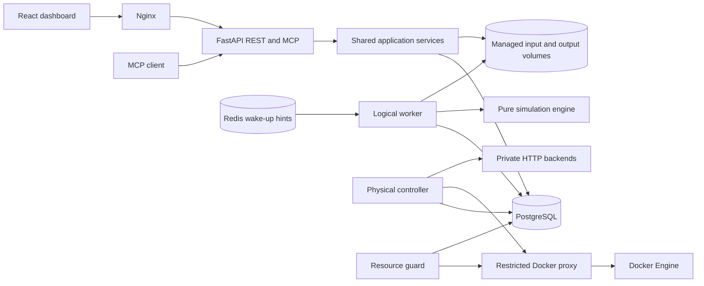

# Design

mslb combines a deterministic logical load-balancer simulator with a server-management
dashboard. It also provides durable jobs, MCP access and a separate real HTTP/Docker
traffic mode. The original [assignment](assignment/requirements.md) defines the mandatory
simulator and dashboard; the additional capabilities are deliberate engineering choices.
Operational commands belong in [DEVELOPMENT](DEVELOPMENT.md), the API reference is served
at `/api/docs`, and generated schemas live in [contracts](contracts/).

## Architecture

| Owner | Responsibility |
| --- | --- |
| `packages/engine` | Standard-library tick engine, selection strategies, exact metrics, simulated autoscaling and independent replay. |
| `packages/contracts` | Strict transport/input models, exact fractions, immutable identities and bounded artifact/checkpoint contracts. |
| `packages/application` | Shared submission/query/cancellation services, managed files, bundles, checkpoint/recovery orchestration and maintenance. |
| `packages/persistence` | PostgreSQL catalog, jobs, leases/fences, progress, publication, resource evidence and physical-resource ownership. |
| `apps/api` | FastAPI composition, REST/OpenAPI, MCP, authentication, request limits and streaming responses. |
| `apps/worker` | Logical execution process, lease supervision, cancellation, health and optional Redis notifications. |
| `apps/container-controller` | Physical job supervisor, routing/scaling, restricted proxy and resource publisher entrypoints. |
| `apps/mock-server` | Bounded private HTTP CPU-work backend and measured health. |
| `apps/web` | React shell, feature workflows, exact-value presentation, playback and streamed downloads. |

Shared packages do not import application adapters. Domain values are immutable dataclasses;
Pydantic validates transport boundaries; SQLAlchemy remains inside persistence. API handlers
enqueue work instead of executing CPU-heavy simulations in the request event loop.

The default deployment has ten runtime roles: `web`, `api`, `worker`, `postgres`, `redis`,
`backend-a`, `backend-b`, `docker-proxy`, `container-controller` and `resource-guard`.
Migrations and credential initialization are bounded startup tasks. Only the gateway and
API/MCP publish loopback ports; internal services remain private.

## Inputs and immutable identity

Servers retain the assignment fields `id`, `cpu_units_per_tick`, `mem_mb` and
`rate_limit_per_sec`; CSV requests retain `t`, `request_id`, `work_units` and `mem_mb`.
Capacities/work are positive integers, arrivals are nonnegative ticks, and booleans or
numeric strings cannot masquerade as JSON integers. Identifiers are trimmed, normalized
to Unicode NFC, byte-bounded and checked for collisions. Servers sort by ID; requests
sort by `(t, request_id)`. CSV ingestion accepts BOM/CRLF, quoting, unsorted rows and
additional named columns while rejecting malformed widths, duplicate headers and invalid
UTF-8 with safe field diagnostics.

Live server CRUD uses optimistic versions. A stale update/delete conflicts atomically;
whole-cluster replacement also validates its expected version. Deleting/recreating an ID
does not reset its history. Submission freezes the selected dataset, server values and
versions, resolved settings and engine identity. Subsequent edits affect future runs only.
Original uploaded bytes and canonical normalized data have separate provenance/digests.

The same scoped idempotency key and request body returns the same run for 24 hours;
a different body with that key conflicts. PostgreSQL, rather than mutable browser state,
owns the immutable registration. Clients submit registered dataset IDs through MCP.

## Logical execution

One tick represents one second. Events at `t` describe the boundary before interval
`[t,t+1)`. Both modes use the same queue, strategy, lifecycle and canonical-output rules:

| Mode | CPU/execution rule | Validation |
| --- | --- | --- |
| `sequential` | At most one running request per server; it receives the server's CPU capacity. This is the default. | Independent replay and, for applicable static runs, the unchanged supplied validator. |
| `concurrent` | All running requests on a server receive equal exact CPU shares for each interval, subject to memory and start-rate limits. | Independent lifecycle/resource replay, including scaling decisions when enabled. |

Supporting both modes covers the supplied sequential evaluator and the assignment's
concurrent execution model. Validation metadata records applicability honestly: concurrent
and dynamic traces are not presented as having passed the serial supplied evaluator.
Legacy stored `sequential_compat` settings remain readable without rewriting old hashes;
new submissions accept `sequential` or `concurrent`.

Each boundary executes this order:

1. Apply previously planned membership changes.
2. Complete prior-interval work and release its reserved memory.
3. Append arrivals and remove permanently infeasible or expired requests.
4. Consider pending requests in stable order and commit eligible starts.
5. Drop residual queue overflow and determine scaling decisions.
6. Account CPU/resource usage for the next interval, unless execution is terminal.

Pending consideration is FIFO with blocked-head bypass: a request that cannot fit does
not stop later eligible requests. Survivors retain their order. An optional timeout expires
at exactly `arrival + timeout`, before scheduling; optional queue capacity keeps oldest
pending requests after immediate starts and drops newest overflow. Capacity zero still
permits immediate starts. Null queue limits disable that policy within installation bounds.
An impossible-memory request drops rather than waiting forever; potential future scaling
template capacity is considered before declaring it impossible.

Eligibility requires sufficient unreserved memory and fewer successful starts at that
boundary than `rate_limit_per_sec`. Sequential mode additionally requires an idle server.
Start counters reset each tick and advance only after a successful start. Memory remains
reserved until completion. A request is never active on more than one server.

| Strategy | Selection and ties |
| --- | --- |
| First Fit | First eligible server in lexical ID order. |
| Round Robin | First eligible ID after the previous successful-start anchor, wrapping to the first; failed selection does not advance the anchor. |
| Least Connections | Fewest active requests, then lexical ID. |
| Most Available Memory | Greatest unreserved memory, then lexical ID. |

Concurrent CPU shares are exact `Fraction(capacity, running_count)` values frozen for an
interval. Consumption is capped by remaining work; unused shares are not redistributed
within that interval. Completion is visible at the next boundary. This makes midflight
arrivals and simultaneous completions reproducible without floating-point rounding.
Analytical idle intervals avoid unnecessary tick-by-tick loops while preserving elapsed
capacity and horizon accounting. A terminal boundary executes no extra interval; an
all-dropped tick-zero run is valid.

### Canonical artifacts and replay

`run.jsonl` contains only `REQUEST_ARRIVED`, `REQUEST_STARTED`, `REQUEST_FINISHED` and
`REQUEST_DROPPED`, with compact UTF-8/LF serialization. Boundary serialization orders
finishes, arrivals, drops and starts, then request/server IDs. Scheduling decision order
and serialization order are deliberately separate. Operational IDs, timestamps and drop
explanations do not enter canonical request lines. Equal normalized inputs, resolved
settings and engine version produce equal logical trace bytes.

Bundles retain normalized inputs, the frozen snapshot, trace, metrics, timeline, drop
details, optional scaling sidecar and a manifest binding file lengths/digests. Single-file
generation writes a temporary candidate and atomically replaces its target only after
successful verification. Bundles publish immutable files and a final fenced database
pointer; failed/cancelled attempts cannot expose partial successful results.

Independent replay reconstructs lifecycle, memory reservations, start counters, exact CPU
shares, terminal boundaries and queue/scaling policy from recorded inputs/events. It does
not call the simulator's scheduling, CPU updater or runtime autoscaler. Hand-calculated
strategy tests supply assignment oracles separately. Hash checks establish integrity;
they are not an independent mathematical proof of every exported metric.

### Metrics, playback and comparison

Incremental metrics include cluster/per-server counts, useful/allocated CPU, integrated
capacity and memory reservations, utilization, queue peak/integral, latency distributions,
makespan, throughput and drop fraction. Useful CPU utilization integrates all active
capacity over `[0, terminal_tick)`, including initial idle time; makespan is the last
terminal tick minus earliest arrival. P50/P95 use nearest rank; empty distributions and
undefined percentage changes remain null. Drops do not become successful latency samples.

Exact noninteger or unsafe-sized quantities use reduced decimal-string fractions, such
as `{"numerator":"2","denominator":"3"}`. JavaScript validates these using BigInt;
charts use presentation approximations while retaining exact values for inspection.
Chart aggregation preserves min/max and time-weighted means in at most 2,000 buckets.
Absent membership intervals are uncovered, rather than invented zeros.

Comparison accepts 2–8 compatible completed logical runs and an explicit first-run
baseline. Dataset, initial cluster, mode, engine and noncompared semantic settings must
match; strategy and simulated scaling may differ. Playback reads saved interval/event
pages and never reruns the engine. Bounded virtual lists, request pages and server lanes
avoid loading whole traces into browser state. Physical measurements are displayed in
the separate Docker workspace and never become logical utilization values.

### Simulated autoscaling

Scaling is optional and disabled by default. A frozen positive-capacity template is
required when enabled. Defaults are a five-interval observation window, CPU out/in
thresholds 4/5 and 1/5, queue threshold 1, drop-ratio threshold 1/10, cooldown 3 ticks and
one-server steps. Resolved membership defaults range from the initial population to
`min(64, initial + 3)`.

Only completed intervals enter CPU/drop observations; the current post-scheduling queue
is used directly. Out triggers are recorded in CPU, queue, drop-ratio order and take
precedence over scale-in. Scale-in requires low CPU, an empty queue, no recent drops and
an idle dynamic server. Original/busy servers are never removed. Changes apply at `t+1`;
the next decision after an action at `t` is eligible at `t + cooldown + 1`. Dynamic IDs
advance deterministically as `autoscale-000001`, etc.; removals select highest IDs first.
Pending changes still apply at final completion, after which no new decisions extend an
otherwise completed run. The independently replayed `autoscaling_decisions.jsonl` sidecar
keeps membership events out of the assignment-facing request trace.

## Durability and recovery

PostgreSQL is the source of truth for catalog history, jobs, progress and ownership.
Submission commits the job, immutable input reference, scoped idempotency and outbox hint
together after managed inputs are durable. Redis carries bounded expiring UUID wake-up
hints only. Missing, duplicate or consumed hints cannot create or lose jobs; polling and
database claiming continue through Redis outages.

Logical execution has a global singleton slot, a default 30-second lease and five-second
renewals. Claims increment attempt/fence. Every mutation checks run, owner, attempt,
fence, allowed state and lease validity using database time. An expired owner cannot
renew, commit progress or publish after replacement. Cancellation and deadlines are
supervised independently of the simulation thread. Infrastructure retry is bounded to
three attempts; deterministic validation/resource/storage failures do not automatically
retry. Physical work has a separate execution/cleanup protocol.

Logical checkpoints capture completed intervals, exact engine/metric/scaler state and
verified output prefixes. Default cadence is 100 executed intervals, 1,000 events or
256 KiB of uncommitted buffered output. Files are flushed/fsynced before fenced SQL
references commit. Restore verifies a separately trusted digest, identities, prefix
hashes/offsets and semantic consistency. Only committed prefixes survive recovery.
A terminal seal supports finalization recovery without replaying already completed
simulation work; final validation and cancellation checks still precede publication.

Managed paths are server-derived, private and protected against symlink/path traversal.
Per-root quotas include spools/orphans and retain a free-space reserve. Idle maintenance
is dry-run by default: with a coherent SQL reference snapshot and writer lock, it may
remove at most 500 unreferenced recognized files older than one hour. Published scopes
and committed references remain protected. History is retained under finite quotas;
there is no claim of unlimited retention or automatic expiry of published results.

## Real HTTP and Docker mode

Explicit `mode: "docker"` submits operational work with wall-clock timing. It is separate
from deterministic tick simulation and cannot be validated as a logical `run.jsonl`.
The controller routes bounded CPU work to private inspected backends using the same four
selection names. Requests reserve logical admission memory; `mem_mb` does not allocate
a matching host buffer. Actual CPU work and health measurements are real.

The driver owns a bounded FIFO and finite inflight tasks, rather than a task per input
row. Queue expiry, overflow, duration limits, HTTP failures and cancellation have explicit
accounted outcomes. Uncertain/interrupted HTTP requests are never retried. Optional
physical scaling uses sustained pending/idle samples, real-second cooldown and min/max
replicas; only idle owned dynamic backends may retire.

Only the restricted proxy accesses the daemon. Separate controller and guard credentials
authorize semantic lifecycle operations or read-only resource probes; neither interface
accepts arbitrary daemon JSON, image, command, mount or network definitions. Creation
persists a single-use intent before sending, then records and reinspects the immutable
container identity. Ambiguous receipts retain reservations until exact reconciliation.
Cleanup stops routing, settles requests and resolves owned resources before successful
publication. A name lookup alone cannot prove an uncertain create never happened.

Operational artifacts are `http_events.jsonl`, `container_lifecycle.jsonl` and
`runtime_summary.json`, alongside matching frozen inputs. Independent verification checks
scope, identities, hashes, HTTP accounting, reservation peaks and resolved lifecycle.
Measured RSS/cgroup peaks and CPU/throttling differences describe sampled windows, not
unsampled maxima. A bounded latest live frame is fence/lease/snapshot bound and expires
after three seconds; stale or terminal frames return unavailable instead of guessed zeros.
Progress writes under a current running lease report a pending cancellation without
mutating the frame, allowing the controller to enter normal cancellation and drain.

## Resource and access boundaries

The production resource guard samples fixed project service identities and engine/VM
headroom, publishing fenced latest evidence to PostgreSQL. Consumers recheck it at
submission, claim, physical growth and publication; running workers also monitor pressure
independently. At 70% of a service limit new increasing work is held; at 85% or observed
OOM, controlled stopping is requested. Recovery needs three distinct samples below 60%.
Timestamp rejections before the evidence write preserve the publisher's acknowledged
lease/revision and reset warmup; uncertain commit receipts still discard local ownership.
Heartbeat failures after acknowledged publication do not discard the publisher lease.
Missing, future-dated or over-three-second evidence fails closed. Redis unavailability
alone does not stop database-backed execution.

The supported engine envelope starts at 8 GiB, with `max(2 GiB, 25% of engine RAM)` reserve
and headroom for potential demand not already represented by measured working sets.
The same policy applies to Linux Engine and Docker Desktop: available memory is measured
inside the Docker/Linux environment, not independently on the Windows host. Runtime cap
sums including startup/dynamic reserves are 3,680 MiB on both environments. Container limits
and fresh Docker evidence protect bounded project execution; they cannot guarantee that
unrelated Windows workloads never exhaust host RAM. No host-side feeder is required.
Resource probe schema version 2 describes this Docker-only policy. Version 1 evidence is
rejected until the fenced publisher replaces the latest report; no saved job, dataset or
result migration/reset is needed. Recreate all runtime roles together after upgrading.

| Bound | Standard installation |
| --- | --- |
| Initial/live logical servers | 1–64 |
| Requests | 10,000; isolated server-selected stress profile permits 50,000 logical requests. |
| Input | 256 KiB server JSON; 10 MiB CSV upload; 2 KiB logical CSV row; 256-byte CSV fields. |
| Execution | Default 100,000-tick horizon, configurable up to 1,000,000; at most 1,000,000 samples and 10,000 historical metric series. |
| Exact arithmetic | At most 4,096 bits per numerator/denominator component. |
| Storage | 32 MiB snapshot/checkpoint, 256 MiB artifact, 512 MiB physical run scope, 5 GiB managed-root quota and 2 GiB free-space reserve. |
| Physical traffic | 10,000 requests, 4 backends total, 16 inflight calls and 120 real seconds. |
| Reads | Bounded cursors/pages and response bytes; general pages are 1–500 items with a 1 MiB encoded ceiling. |

Cursor HMACs bind collection, identity and filters with a 24-hour lifetime. Artifact
downloads resolve a fixed allowlist, verify length/hash before success headers and stream
bounded chunks; callers never choose storage paths. Local-demo and bearer access retain
Host/Origin, URL-credential and request-size checks. Browser credentials stay in memory.
The public ReDoc shell/assets load locally; authenticated schema access uses an ephemeral
bearer loader without persisting credentials. Documentation CSP is scoped separately from
the stricter dashboard policy.

Runtime services use finite memory/CPU/PID limits, bounded pools, private networks,
read-only roots and dropped privileges where supported. PostgreSQL's volume-initialization
exception is explicit. Safe diagnostics expose bounded codes/correlation metadata rather
than raw exceptions, tokens, uploaded rows, SQL or dependency URLs.

## Trade-offs and verification scope

Exact arithmetic and immutable artifacts prioritize reproducibility over unlimited input
size. Blocked-head bypass improves useful scheduling while relaxing strict FIFO starts.
Separate workers, fencing and a restricted proxy add complexity beyond a small in-process
simulator, but preserve responsive APIs and explicit recovery/ownership boundaries.
Replay, hashes and finite tests provide complementary evidence rather than a formal proof.

The recorded implementation has completed Docker build/static/schema, Python integration,
REST/MCP, Chromium, process-recovery and scoped physical-fault checks. Separate Windows
Desktop and Ubuntu Engine on WSL2 runs were recorded; their scope is not bare-metal Linux
or a cold-image-cache guarantee. The latest completed maintenance gate and the later
focused Just fix are described in [DEVELOPMENT](DEVELOPMENT.md). No new full test run is
implied by this documentation consolidation.

Long-session/all-browser accessibility certification, remote HTTPS/security acceptance,
broader resource/recovery campaigns and CI/hooks remain follow-up work. Observability is
deferred and Grafana is excluded. Implemented runtime readiness is an admission signal,
not a certificate that every delivery or platform acceptance condition has been met.
